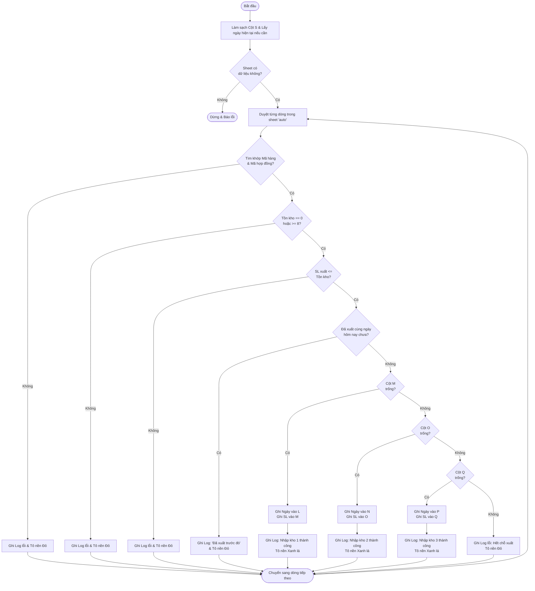

# LOGIC XUẤT KHO TỰ ĐỘNG

Tài liệu này mô tả quy trình và logic tự động hóa việc xuất kho từ sheet `auto` sang sheet `成品出入库明细 汇总表`.

## 1. Chuẩn bị & Tiền xử lý

- **Kiểm tra dữ liệu:** Đảm bảo các sheet có dữ liệu. Nếu sheet trống, dừng xử lý và đưa ra cảnh báo.
- **Làm sạch Log:** Xóa toàn bộ dữ liệu cũ trong **Cột Q** (Cột báo lỗi/log) trước khi thực hiện bất kỳ thao tác nào để tạo không gian chứa log mới rõ ràng.
- **Ngày xuất kho:** Kiểm tra biến `CONFIG.day`. Nếu để trống, hệ thống tự động lấy **ngày/tháng/năm** (VD: 25/04/2026) hiện tại để sử dụng.

---

## 2. Quy trình kiểm tra và đối chiếu (Theo từng dòng)

Đối với mỗi dòng dữ liệu cần xuất trong sheet `auto`, thực hiện tuần tự các bước sau:

### 2.1. Đối chiếu thông tin

Tìm kiếm dòng tương ứng trong sheet `成品出入库明细 汇总表` khớp đúng 3 điều kiện:

1. **Mã hàng:** Cột C (`auto`) khớp với Cột D (`Tổng hợp`).
2. **Mã hợp đồng:** Cột B (`auto`) khớp với Cột J (`Tổng hợp`).
3. **Vị trí kho:** Cột O (`auto`) khớp với Cột K (`Tổng hợp`).

> 🛑 **Xử lý lỗi:** Nếu **không tìm thấy** dòng nào khớp cả 3 điều kiện -> Ghi log lỗi vào Cột S và bỏ qua dòng này.

### 2.2. Kiểm tra tồn kho & Điều kiện xuất

Lấy số lượng xuất từ **Cột H** của sheet `auto`. Sau đó kiểm tra:

1. **Điều kiện tồn kho:** Số lượng tồn kho hiện tại (`Tổng hợp` Cột **AJ**) phải bằng `0` HOẶC `>= 8`.
2. **Điều kiện xuất:** Số lượng xuất phải `<= Tồn kho`.

> 🛑 **Xử lý lỗi:** Nếu không thỏa mãn một trong các điều kiện trên -> Ghi log lỗi vào Cột S và **KHÔNG** thực hiện ghi dữ liệu.

### 2.3. Kiểm tra trùng lặp

- Nếu mã hàng và mã hợp đồng này **đã được xuất kho trước đó trong cùng một ngày** thực hiện (Vẫn phải kiểm tra tồn kho đủ hay không ở bước trên).
- -> Bỏ qua không ghi mới và ghi log vào Cột S: _"Mã hàng này đã được xuất kho trước đó"_.

---

## 3. Quy trình ghi dữ liệu xuất kho

Hệ thống hỗ trợ xuất kho tối đa **3 lần** cho cùng một mã hàng/hợp đồng trên một dòng. Trình tự ghi dữ liệu ưu tiên như sau:

| Lượt xuất | Cột Ngày xuất | Cột Số lượng xuất | Điều kiện thực hiện                                  |
| :-------- | :-----------: | :---------------: | :--------------------------------------------------- |
| **Lần 1** |    Cột AC     |      Cột AB       | Nếu Cột AC chưa có dữ liệu                           |
| **Lần 2** |    Cột AE     |      Cột AD       | Nếu Cột AC đã có, nhưng Cột AE chưa có dữ liệu       |
| **Lần 3** |    Cột AG     |      Cột AF       | Nếu Cột AC và AE đã có, nhưng Cột AG chưa có dữ liệu |

> 🛑 **Xử lý lỗi:** Nếu cả 3 cột xuất kho (AC, AE, AG) đều đã có giá trị -> Không thể ghi thêm, ghi log lỗi vào Cột S.

---

## 4. Định dạng và Trạng thái Log (Cột Q)

Cột Q đóng vai trò theo dõi trạng thái. Định dạng màu sắc giúp kiểm tra trực quan:

- ✅ **THÀNH CÔNG:**
  - **Nội dung:** Ghi rõ lượt nhập. VD: _"Nhập kho 1 thành công"_, _"Nhập kho 2 thành công"_, _"Nhập kho 3 thành công"_.
  - **Định dạng:** Tô nền **Xanh lá**, chữ **Trắng**.

- ❌ **THẤT BẠI / LỖI:**
  - **Nội dung:** Ghi rõ lý do lỗi. VD: _"Nhập kho 1 thất bại"_, v.v.
  - **Định dạng:** Tô nền **Đỏ**, chữ **Trắng**.

---

## 5. Sơ đồ luồng xử lý (Flowchart)

Trực quan hóa logic bằng sơ đồ nhánh:

